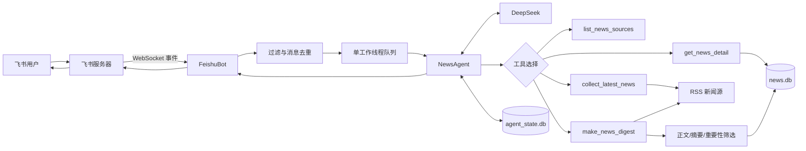

# 飞书财经与 AI 新闻 Agent

这是一个面向个人使用的新闻 Agent：用户在飞书私聊中用自然语言提问，Agent 会根据问题自主选择工具，采集财经或 AI 新闻、生成中文摘要、筛选重要内容，并利用会话记忆回答后续追问。

> 本项目用于学习 Agent 工程，不构成投资建议。

## 项目亮点

- 使用飞书 WebSocket 长连接接收私聊消息，不需要公网服务器或内网穿透。
- 使用 DeepSeek 作为推理模型，使用 LangChain `create_agent` 组织工具调用。
- Agent 可自主选择 4 个新闻工具，而不是依赖用户输入固定命令。
- 支持新闻采集、正文提取、中文摘要、重要性筛选和新闻详情追问。
- 使用 SQLite 保存新闻、摘要和会话状态，避免重复采集和重复消耗模型额度。
- 使用结构化输出和 Pydantic 校验新闻 ID，降低模型生成无效数据的风险。
- 支持消息去重、串行处理、失败重试和损坏会话自动恢复。
- RSS 来源并发采集；在本机测试网络下，单类采集耗时由约 40 秒降至约 16 秒。

## 已实现能力

用户可以在飞书私聊中发送：

```text
当前有哪些 AI 新闻来源？
给我过去 24 小时最重要的 3 条财经新闻
整理最近一周与 OpenAI 相关的 AI 新闻
给我 5 条 AI 新闻，每条用两句话总结
详细解释刚才第 2 条
```

为了方便使用，也保留了以下快捷指令：

```text
帮助
今日财经
今日AI
今日早报
```

当前版本仅处理飞书私聊文字消息。

## 为什么它是 Agent

DeepSeek 不只负责生成最终回答，还会先根据用户意图决定是否调用工具、调用哪个工具以及如何填写参数。例如：

```text
用户：给我过去 24 小时最重要的 3 条财经新闻
             ↓
模型选择：make_news_digest
             ↓
模型参数：category=finance, limit=3, max_age_hours=24
             ↓
程序执行工具并返回数据
             ↓
模型根据工具结果组织最终回答
```

工具是否执行由模型结合系统提示词、工具名称、工具说明和参数结构决定；真正的网络请求、数据库操作仍由 Python 代码执行。

## 系统架构



核心数据流：

```text
飞书消息
→ WebSocket
→ 私聊与文本过滤
→ message_id 去重
→ 后台任务队列
→ Agent 判断是否调用工具
→ RSS / SQLite / DeepSeek
→ Agent 生成最终回答
→ 飞书发送消息
```

## Agent 工具

| 工具 | 使用场景 | 主要参数 |
|---|---|---|
| `list_news_sources` | 询问当前配置了哪些来源 | `category` |
| `collect_latest_news` | 获取最新新闻列表，不要求摘要 | `category`、`limit`、`max_age_hours`、`keywords` |
| `make_news_digest` | 请求早报、整理或中文摘要 | `category`、`limit`、`max_age_hours`、`keywords` |
| `get_news_detail` | 追问之前列表中的某条新闻 | `news_id` |

`make_news_digest` 内部会完成：

1. 并发读取 RSS 来源。
2. 按时间范围、关键词和标题去重。
3. 使用 URL 唯一约束写入 SQLite。
4. 尝试提取网页正文，失败时回退到 RSS 摘要。
5. 只为尚未缓存摘要的新闻调用 DeepSeek。
6. 使用结构化输出选择指定数量的重要新闻。
7. 将候选新闻返回给主 Agent 组织最终回答。

## 技术栈

| 分类 | 技术 |
|---|---|
| 语言与环境 | Python 3.12、uv |
| Agent | LangChain、LangGraph Checkpointer |
| 大模型 | DeepSeek OpenAI-compatible API |
| 飞书 | `lark-oapi`、WebSocket 长连接 |
| 数据 | SQLite |
| 新闻采集 | RSS/Atom、feedparser、httpx |
| 正文提取 | trafilatura |
| 数据校验 | Pydantic |

## 项目结构

```text
BOT/
├── data/
│   ├── news.db                 # 新闻、正文和摘要缓存
│   └── agent_state.db          # Agent 会话状态
├── reports/                    # 测试和调用记录
├── scripts/                    # 初始化、测试和验证脚本
├── src/bot/
│   ├── agent.py                # 主 Agent、工具注册、记忆与状态恢复
│   ├── tools.py                # 4 个 Agent 工具
│   ├── feishu.py               # 飞书事件接收、去重、队列和回复
│   ├── news.py                 # RSS 配置加载、并发采集和过滤
│   ├── database.py             # SQLite 新闻仓库
│   ├── content.py              # 网页正文提取与 RSS 回退
│   ├── content_service.py      # 正文缓存服务
│   ├── summary_service.py      # 中文摘要生成与缓存
│   ├── selector.py             # 重要新闻结构化筛选
│   ├── models.py               # Pydantic 数据模型
│   ├── deepseek.py             # 普通 DeepSeek API 封装
│   ├── config.py               # 环境变量读取与检查
│   └── app.py                  # 应用入口
├── .env.example
├── news_config.json            # 新闻来源和默认采集参数
├── pyproject.toml
└── main.py
```

## 环境要求

- Python 3.12
- uv
- 飞书企业自建应用
- DeepSeek API Key

检查环境：

```powershell
python --version
uv --version
```

## 飞书应用配置

在飞书开放平台创建企业自建应用，并完成以下配置：

1. 添加“机器人”应用能力。
2. 开通读取私聊消息和以机器人身份发送消息的权限。
3. 在“事件与回调”中选择长连接。
4. 订阅 `im.message.receive_v1`。
5. 创建并发布应用版本。
6. 确保应用可用范围包含自己的飞书账号。

常用权限包括：

```text
im:message.p2p_msg:readonly
im:message:send_as_bot
```

## 安装项目

进入项目目录：

```powershell
cd E:\agent_learning\BOT
```

根据锁文件创建或更新环境：

```powershell
uv sync
```

复制环境变量模板：

```powershell
Copy-Item .env.example .env
```

在本地 `.env` 中填写：

```dotenv
FEISHU_APP_ID=你的飞书App ID
FEISHU_APP_SECRET=你的飞书App Secret
DEEPSEEK_API_KEY=你的DeepSeek API Key
DEEPSEEK_BASE_URL=https://api.deepseek.com
DEEPSEEK_MODEL=deepseek-flash
```

不要把 `.env`、App Secret 或 API Key 上传到 Git，也不要发送到聊天中。

## 运行

```powershell
uv run python main.py
```

首次启动需要加载 LangChain 和飞书 SDK，可能等待 30～45 秒。看到下面日志后才表示开始监听飞书消息：

```text
Starting Feishu WebSocket client. Press Ctrl+C to stop.
```

按 `Ctrl+C` 停止。

## 配置新闻来源

编辑 `news_config.json`：

```json
{
  "ai": {
    "default_limit": 5,
    "per_source_limit": 10,
    "max_age_hours": 168,
    "sources": [
      {
        "name": "OpenAI",
        "url": "https://openai.com/news/rss.xml"
      }
    ]
  }
}
```

字段说明：

- `default_limit`：该类别的默认返回条数。
- `per_source_limit`：合并前，每个来源最多读取多少条。
- `max_age_hours`：丢弃超过该小时数的新闻。
- `sources`：RSS/Atom 来源名称与 URL。

当前配置包含 3 个财经来源和 4 个 AI 来源。修改后运行：

```powershell
uv run python scripts/test_news_collection.py
```

## 数据与记忆

项目使用两个 SQLite 文件：

- `data/news.db`：保存新闻标题、URL、来源、发布时间、正文和摘要。URL 具有唯一约束，同一条新闻重复采集不会重复插入。
- `data/agent_state.db`：保存 LangGraph 会话状态。飞书 `chat_id` 作为 `thread_id`，因此同一私聊可以连续追问。

如果程序在工具执行中途退出，可能留下不完整的工具调用。`NewsAgent` 会在下一次请求前检查历史；发现缺少 `ToolMessage` 时，只重置该会话，不删除新闻数据库。

## 测试

项目目前提供 19 个可单独运行的验证脚本。建议至少执行：

```powershell
# DeepSeek 连接
uv run python scripts/test_deepseek.py

# RSS 新闻采集
uv run python scripts/test_news_collection.py

# Agent 是否选择来源工具
uv run python scripts/test_agent_sources.py

# Agent 是否生成早报
uv run python scripts/test_agent_digest.py

# 会话记忆隔离
uv run python scripts/test_agent_memory.py

# “详细解释第2条”追问
uv run python scripts/test_agent_news_followup.py

# 不完整工具调用检测
uv run python scripts/test_agent_state_guard.py
```

## 稳定性设计

- 飞书事件回调快速返回，耗时任务放入后台线程。
- 个人 Bot 使用单工作线程，避免同一 SQLite Checkpointer 被并发写入。
- `NewsAgent` 使用锁保护 Agent 和会话数据库。
- 最近 1000 个 `message_id` 在内存中去重。
- DeepSeek 请求支持重试。
- RSS 来源并发读取，单个失败来源不会阻塞其他结果。
- 新闻 URL 唯一约束保证数据库幂等。
- 摘要和正文写入 SQLite 缓存。
- Pydantic 校验重要新闻 ID 为正整数且不能重复。
- 工具调用历史损坏时自动重置对应会话。

## 常见问题

### 启动后暂时没有日志

首次加载依赖可能需要 30～45 秒。等待 `Starting Feishu WebSocket client`。

### 飞书回复“新闻 Agent 暂时不可用”

查看终端完整异常。常见原因包括 DeepSeek 网络中断、代理 SSL 错误、API Key 无效或所有新闻源都连接失败。

### 终端出现 `Article extraction failed`

部分新闻网站禁止自动读取或需要登录。程序会回退到 RSS 摘要；这条警告不一定代表整次任务失败。

### 新闻回复比较慢

第一次生成新闻摘要需要采集来源、读取正文和调用模型。摘要进入 SQLite 缓存后，再次请求同一新闻会更快。

### 修改来源后没有新闻

确认 URL 是可访问的 RSS/Atom 地址，并检查 `max_age_hours` 是否过小。

## 当前限制

- 仅支持飞书私聊文字消息。
- Bot 必须在本机进程运行时才能回复。
- 暂未实现群聊 `@机器人`、定时主动推送、OAuth 日历、RAG 和图片理解。
- 部分付费墙或反爬网站只能使用 RSS 摘要。
- Bing 聚合搜索可能混入相关性较弱的内容。
- 消息去重记录保存在内存中，进程重启后会重新开始记录。
- 当前测试主要是可执行脚本，尚未迁移为完整的 pytest 自动化测试套件。

## 后续计划

1. 增加来源可信度和标题—正文一致性过滤。
2. 将测试脚本整理为 pytest，并为网络调用增加 mock。
3. 增加耗时、工具调用和失败率指标。
4. 增加每日定时早报和主动推送。
5. 增加群聊支持和用户权限控制。
6. 增加 RAG 文档问答与新闻主题检索。

